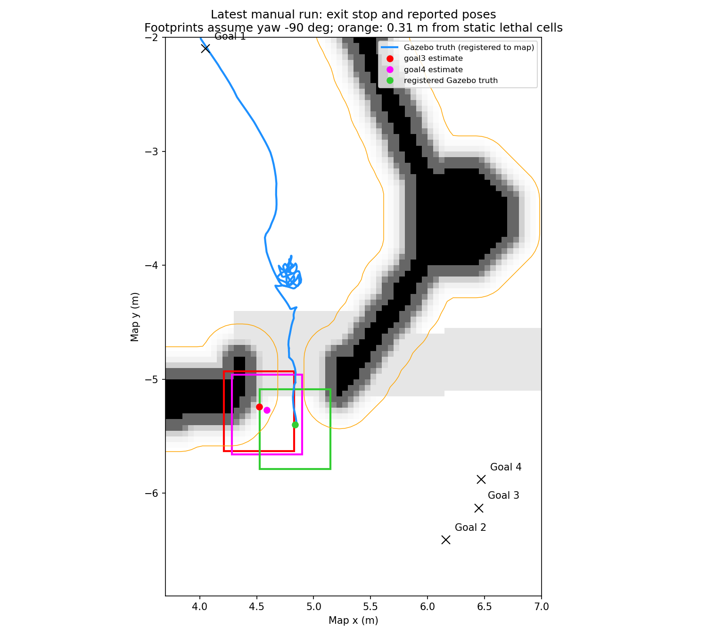

# 最新四目标手动仿真诊断（2026-11-13）

> 归档说明（2026-11-14）：本目录保留结论、脚本和精简证据。大型原始数据已转入本机 `backup/report-evidence-2026-11-14.tar.zst`，源码快照、编译产物和重复中间记录已清理；清单与恢复方法见 `reports/maintenance/2026-11-14/commit_cleanup/README.md`（路径均从仓库根目录解析）。下文的 before/after、trace 和输入文件路径按原实验记录保留，现存状态以清单为准。

结论：本次“洞口前 yaw 摇晃”和“出洞后停车、后续目标也不动”涉及不同阶段。结合先前独立底盘/命令链实验，yaw 的主要问题仍指向导航闭环与命令延迟。最新日志直接证实，后半段导航仍接收新目标，但区域控制器遇障停车，随后切到 MPPI 后连续无可行控制；第三目标还被规划器明确拒绝为 `Start occupied`。定位可信门曾暂时停车，但恢复放行后控制失败仍持续。

另外，已用当前生产几何代码复现一个独立缺陷：重规划路径只保留洞外后缀时，`ZoneTracker::setPath()` 会丢弃尚未完成的出洞 crossing，车尾未离开洞体也可提前把控制权交回 MPPI。本次日志与此机制吻合，但没有记录本次运行的实际路径，不能把该机制认定为已逐帧证实的唯一根因。

本轮只保存证据、诊断脚本并更新问题记录/项目记忆；未修改正式导航、定位、仿真、地图或参数，未提交 Git。

## 输入与时间线

输入为 `/tmp/nav_manual_gui` 最新会话的日志副本。本目录保存的日志含更早会话，以下仅分析 22:33 开始的四目标；时间为 Asia/Shanghai，导航日志行号以本目录 `nav.log` 为准。

| 目标 | 接收时间 | map 目标 (m) | 日志结果 |
|---|---|---|---|
| 1 | 22:33:33.577 | (4.05, -2.10) | 22:33:46.048 成功 |
| 2 | 22:33:48.083 | (6.16, -6.41) | 洞前摆动后通过洞口；出洞附近停止，22:34:32.323 失败 |
| 3 | 22:34:40.568 | (6.45, -6.13) | 已接收，多次 `Start occupied`；后续也出现 MPPI 失败，被目标 4 抢占 |
| 4 | 22:34:45.708 | (6.47, -5.88) | 已接收，重置恢复计数后仍反复控制失败，22:34:58.951 失败 |

目标接收行：968、979、1741、1914。第 3、4 目标没有被忽略；第 4 目标的恢复从 attempt 1/5 开始，不是旧目标失败计数永久锁住。

更完整事件表见 `timeline.json`。

## 1. 洞口前 yaw：与前一轮诊断的关系

最新运行 22:33:50.224 进入 `slope_3+tunnel_3` 跟踪，锁定航向约 -89.6°。Gazebo 真值轨迹在洞前约 map (4.8, -4.0) 附近反复移动后继续通过。

先前独立 Gazebo 恒角速度实验 ±0.3/0.6/1.0 rad/s 的稳态误差均 <0.07%；洞口路线复现中，最终 `/cmd_vel` 到真值约 40–50 ms，而导航输出到真值约 470–480 ms，碰撞监控输出约 4.94 Hz。临时关闭 `base_shift_correction` 后恢复约 30 Hz 并显著改善摆动。完整数据见相邻 `../yaw_diagnosis/README.md`。

这支持优先排查导航闭环及命令链。上述量化延迟来自前一轮路线复现，不能冒充最新四目标运行的逐时刻测量；最新运行未录制分级速度话题或 tracker trace。

## 2. 出洞停车的直接日志链

- 22:34:06–21：`ZoneAwareController` 多次报 `obstacle on the path ahead, stopping`（例如 nav.log 1016–1040）。该检查会把当前输出置零，检查完整 padded footprint 沿参考路线和实际制动轨迹是否碰撞，并非单纯跟踪误差。
- 22:34:12.861：`cmd_gate` 报 `holding: localization not trusted`（1030 行）。
- 22:34:21.514：新一次平滑路径请求；22:34:21.559 控制器 `Passing new path`，同一时刻 tracker 打印 `done`，模式 `tunnel -> normal`（1041–1045 行）。这里的 `done` 只说明 tracker 权重变为 0，不能证明整车物理离洞。
- 22:34:22.465 开始 MPPI `Optimizer fail to compute path`（1051 行）；随后 `Failed to make progress`，恢复流程只清图。
- 22:34:22.661：可信门已 `released`（1060 行）。之后仍大量 `Optimizer fail to compute path` / `Controller patience exceeded`。持续停车不能只归因于可信门锁住。
- 22:34:32.323：第 2 目标清图恢复 5 次后放弃（1736–1738 行）。
- 22:34:40.569 起，第 3 目标规划器多次 `Start occupied`（1742、1745、1757、1760、1772 行）。清图后仍出现，后续即使规划成功，MPPI 也未恢复运动。
- 第 4 目标重新接受、恢复重置后仍控制失败，22:34:58.951 放弃（2912 行）。

注册到 map 的 Gazebo 真值在 22:34:21 附近约 (4.85, -5.39)，之后至第 4 目标结束约 (4.84, -5.40)，确实没有继续接近目标，并非只有 RViz 显示不动。

## 3. `Start occupied` 的几何解释

对当前 `maps/sim/terrain/nav_map.yaml` 与静态图进行离线检查。原 footprint 为前 0.38 m、后 0.30 m、半宽 0.30 m，padding 0.01 m；检查使用 padded 多边形 [(0.39,0.31),(0.39,-0.31),(-0.31,-0.31),(-0.31,0.31)]，内切半径 0.31 m。

| 停车位姿来源 | map (m) | 到最近静态 lethal 格中心 | yaw=-90° 时车体与 lethal 格重叠 |
|---|---|---|---|
| 目标 3 接收时导航报告位置 | (4.52, -5.24) | 0.185 m | 24 格 |
| 目标 4 接收时导航报告位置 | (4.59, -5.27) | 0.259 m | 16 格 |
| 配准后的 Gazebo 真值参考 | (4.836, -5.400) | 0.476 m | 0 格 |

前两者中心所在原图像素分别为 233、251，本身不是 lethal；但附近 lethal 格已落入车体内切圆，无论 yaw 取何值都存在静态几何重叠。这足以解释膨胀后起点占用和控制轨迹无可行解，不必先假定是传感器残留假障碍。清除代价图会重新装入静态障碍，不能消除这种几何冲突。



蓝线为 Gazebo 真值换算到 map 的轨迹；红/紫为导航报告位置的车体示意，绿为真值参考的车体示意，轮廓方向统一取 -90°。橙线是源图 lethal 格约 0.31 m 距离线，只作几何说明，不是运行时 costmap 快照。

误差边界：这里用 `terrain.json.registration` 的平移/偏航将 world 真值换算到 map，忽略小 roll/pitch；配准自身 residual p50≈0.032 m、p90≈0.201 m。第 3、4 目标报告位置与真值参考相差约 0.35、0.28 m，不能把全部差值精确归为定位误差。当前证据支持检查“定位与地图几何的一致性”，尚不足以单独定责定位或地图。未记录实时 costmap，无法断言运行时所有阻塞格都来自静态层。

精确距离与 footprint 结果见 `static_map_checks.json`。`source_cell_edt_distance_m` 是中心落格的 EDT 值，`nearest_lethal_cell_center_distance_m` 是直接从报告坐标到 lethal 格中心的精确距离，两者勿混用。

## 4. 已复现的出洞后缀重规划缺陷

`src/nav_behaviors/src/zone_tracker.cpp:33` 的 `setPath()` 先交换掉旧 crossings，再仅为新路径中进入 zone body 的路径点创建 crossing。旧 crossing 的 heading lock 仅在新 crossing 创建成功后才继承；若新路径起点已越过远洞口，整个后缀不再进入 body，则旧 crossing 被丢弃。`compute()` 在 crossings 为空时直接返回 weight=0。

`src/nav_behaviors/src/zone_aware_controller.cpp:247` 将新路径交给 tracker；262 行 weight<=0 立即调用 inner MPPI。544 行打印的 `done` 也是依据 weight，而非车尾是否离洞。

最小复现直接编译当前生产 `zone_tracker.cpp` / `path_shaper.cpp` / `zone_state.cpp`：洞深 0.35 m、宽 0.8 m、沿 +x，车心 x=0.4 m，车尾 x=0.09 m，远洞口 x=0.175 m，车尾仍在洞内。

```text
full crossing path: phase=exit weight=1 crossings=1
replan suffix path: phase=none weight=0 crossings=0
rear coordinate=0.09 far mouth=0.175 (rear still inside body)
```

同一车位，只把完整过洞路径换为从 x=0.4 开始的后缀即触发提前退出。复现命令：

```bash
bash /home/yang/yang_nav/reports/navigation/2026-11-13/manual_four_goals/scripts/exit_suffix.sh
```

本次运行新路径到达后立即 `done -> normal -> MPPI fail` 与此机制吻合，但实际运行路径未保存，因此仍需修复后用带路径/phase/速度记录的通行测试确认实际影响。此最小复现证明缺陷存在，不证明它是本次全部停止行为的唯一原因；更早已存在 obstacleAhead 停车与定位门暂停。

本轮关键三次过洞整形在 epoch 1794580428.104、0439.254、0450.394 均打印成功。不能直接套用前一轮“整形失败后原始路径可能泄漏”的诊断来解释本次退出。

## 5. 恢复为何清图但不转身/倒车

`src/nav_behaviors/src/zone_recovery.cpp:68` 还会用 TF 检查扩展 zone（margin 0.55 m）内是否仍有车。即使 tracker 已报 done、phase 过期，也不自动允许旋转或倒车。上述停车点仍落在扩展 tunnel_3 内；离线区域检查见 `exit_zone_checks.json`。

因此日志持续 `clear (in a zone, no motion)` 是区域内安全策略，不是恢复线程失效。盲目解除该保护不能解决位姿/地图碰撞，也可能在车尾未离洞时转身碰撞。

## 6. 定位事件与下一步

`loc.log:2289`，22:34:12.829 NORMAL -> SUSPECT，原因 `observation model invalid`；22:34:22.636 UWB+scan-to-map 恢复，修正 0.284 m / 3.34°。随后 22:34:28–41 多次 SUSPECT/NORMAL，修正包含 0.514 m、0.561 m。首次日志的 predicted offset≈10.19 m 是被拒绝的匹配候选，不是已确认的当前定位误差。

按项目约定，已补充 `docs/localization_issues.md`，导航直接使用定位输出，不加入滤波或纠偏。

建议修复/验证顺序：

1. 修复命令链延迟和出洞后缀重规划时丢失 exit 状态的问题；保留完整车体碰撞检查和可信门。
2. 记录出洞的 TF、定位状态、global/local costmap、参考路径与 Gazebo 真值，区分定位偏移、地图配准误差和实时障碍层对占用判定的贡献。
3. 用同一四目标回归，验收 yaw 收敛、车尾完全出洞前控制权连续、到达第 2 目标及第 3/4 目标可继续执行。仅清图或只降低 yaw 增益不能作为本问题已解决的依据。

诊断脚本在 `scripts/`；已归档的 `manual_four.py` 只解析本目录保存的日志，不读取后续变化的 `/tmp` 会话。静态检查和最小复现也可直接重跑。
