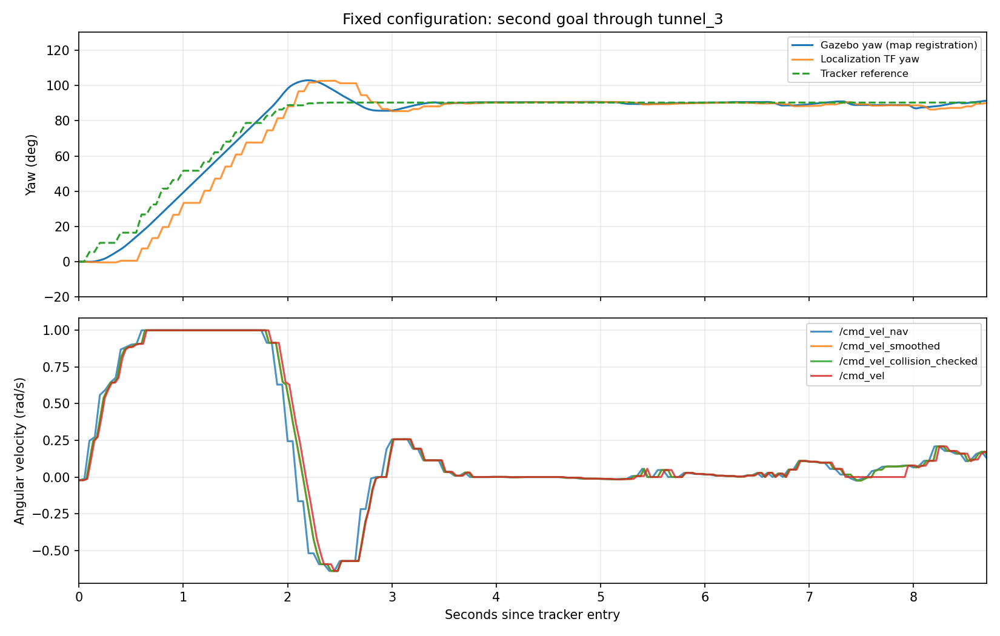

# 洞口摇晃、出洞停车及占用起点修复验证

> 归档说明（2026-11-14）：本目录保留结论、脚本和精简证据。大型原始数据已转入本机 `backup/report-evidence-2026-11-14.tar.zst`，源码快照、编译产物和重复中间记录已清理；清单与恢复方法见 `reports/maintenance/2026-11-14/commit_cleanup/README.md`（路径均从仓库根目录解析）。下文的 before/after、trace 和输入文件路径按原实验记录保留，现存状态以清单为准。

已修改正式导航代码/参数并编译安装。Gazebo 按最新日志四个目标坐标复测，四个目标均返回成功；第二目标穿过 tunnel_3 后继续到达终点，第三、第四目标继续成功。此次只处理导航，未修改定位源码、地图和手工地形标注，未提交 Git；原有未提交修改和暂存保留。

## 改动

1. **命令链延迟**：`collision_monitor.base_shift_correction=false`。输入障碍点云已经在固定 map 坐标系，使用最新 map→base TF，避免等待估计器尚未发布的当前时刻变换。观测过期、无效变换停车和完整 footprint approach 保护继续开启。正式 `trace` 仍为 false，仿真只临时打开 trace。
2. **出洞后缀重规划**：`ZoneTracker` 对从远洞口之外开始、向外离开的路径重建 EXIT crossing。重规划或冷启动不再因为路径里没有洞体点而直接退出。车尾清空洞体之前保持区域控制和洞体航向，之后平滑接回后缀航向。侧向经过区域和超过出口窗口的路径不会误锁存。
3. **占用起点可继续导航**：新增 `StartAwarePlanner`，包括车体与障碍重叠、车心落入 lethal 区域、只有膨胀带导致起点不可用的情况。先搜索保持实际车体朝向的平移退出段，再从空闲端点调用原 Smac2D。默认退出段上限 1.5 m，执行速度 0.15 m/s，不旋转、不清除或篡改共享 costmap。
4. **贯通退出段**：整形器保留并验证退出前缀，只对空闲后缀正常整形；控制器依据实时局部地图重新检查并执行退出，先制动旧的旋转和侧向惯性。完全嵌入较厚障碍时可以沿起初接触的同一连通障碍退出；车体重叠面积不能增加，新的独立障碍、未知和越界仍被阻止。控制器为一次退出冻结原始障碍范围，兼容滚动地图原点变化。一旦退出，普通完整车体检查继续生效。
5. **路径与目标绑定**：规划输出 `{raw_path}`、整形结果 `{shaped_path}`、执行路径 `{path}` 分离。两个 BT 都在规划前记录目标签名，仅在整形成功且目标没变时提交执行路径。新目标等待自己的路径，防止原始路径泄漏，也防止新目标规划未完成时沿用旧路径、按旧终点误报成功。规划/整形过程中旧结果晚到也无法绑定给新目标。

主要源码：

- `src/nav_behaviors/include/nav_behaviors/overlap_escape.hpp`
- `src/nav_behaviors/src/start_aware_planner.cpp`
- `src/nav_behaviors/src/zone_path_shaper.cpp`
- `src/nav_behaviors/src/zone_aware_controller.cpp`
- `src/nav_behaviors/src/zone_tracker.cpp`
- `src/nav_behaviors/include/nav_behaviors/zone_path_handoff.hpp`
- `src/nav_bringup/behavior_trees/navigate_to_pose.xml`、`navigate_through_poses.xml`
- `src/nav_bringup/params/sim/nav2.yaml`

退出前缀是针对已有地图重叠的有界例外，不代表任意占用区域都存在可通行的物理出口。如果 1.5 m 内没有满足限制的退出路线，或实时碰撞监控/定位可信门要求停车，仍会停车并报告原因；不会把实体障碍一律当作可穿越。未放开洞内盲目旋转/倒车恢复，也未加入导航侧定位滤波或修正。

## 验证结果

| 验证 | 结果 | 证据 |
|---|---|---|
| nav_behaviors / nav_bringup 编译安装 | 通过 | `build_final.log` |
| 当前 nav_behaviors 单元用例 | 82/82，无失败/错误 | `unit_final.log`、`unit_xml/` |
| 完整真实 Nav2 + 运动学底盘闭环 | 13/13 | `framework2/result.json` |
| 边角重叠、车心处于较厚占用区、退出后新目标 | 4/4 | `occupied/result.json` |
| 正式地图上两个旧停车坐标退出、到点、后续目标 | 4/4 | `recorded_exit/result.json` |
| Gazebo + 原定位 + 正式地图，四目标路线 | 4/4，error_code 全为 0 | `gazebo/goals.log`、`gazebo_console.log` |

13 项闭环包含：隧道通行、洞内目标、停止后重新发目标、障碍停车/清除后恢复、洞内取消、抢占、观测丢失与定位不可信停车、多目标方向地形和已到达目标。新增单元用例覆盖出洞后缀、反向通过、冷启动、无关路径不锁存；占用区退出、新障碍/旋转/未知/越界拒绝、重叠面积增加拒绝、滚动原点、膨胀带起点，以及新目标不能使用旧规划/整形结果。

`occupied_start.py` 使用运动学底盘验证代价地图重叠处理，不模拟真实车体穿入实体墙后的接触力学。带 `--recorded-exit` 时使用正式地图及手动日志停车位姿 (4.52,-5.24,-90°)、(4.59,-5.27,-90°)，并未修改地图让测试通过。

### Gazebo 四目标

本次根据手动日志坐标重跑，目标朝向统一为 0°；原 RViz 日志没有目标朝向，因此不是原运行的逐指令确定性回放。

| 目标 map (m) | 返回结果 | 目标执行墙钟耗时 |
|---|---|---|
| (4.05,-2.10) | SUCCEEDED / 0 | 8.1 s |
| (6.16,-6.41) | SUCCEEDED / 0 | 15.9 s |
| (6.45,-6.13) | SUCCEEDED / 0 | 12.2 s |
| (6.47,-5.88) | SUCCEEDED / 0 | 1.1 s |

新运行在出洞后的普通模式也实际触发了一次低速退出，再恢复路径跟踪并到达第二目标。第三目标期间出现定位 IMU-gap 重置，定位恢复后仍成功，导航没有绕过可信门。相关日志已保存，定位代码未改。

### yaw 与命令链

- 碰撞监控输出中位频率约 **30.30 Hz**，上游 smoother 约 30.28 Hz；此前原配置诊断约 4.94 Hz。
- 本轮 smoother→collision_checked 信号估计延迟约 **0 ms**（10 ms 分辨率），最终命令仍约 30 Hz。
- 导航角速度→Gazebo 真值角速度互相关估计延迟约 **0.11 s**、相关系数 0.982；最终命令→真值约 **0.04 s**、相关系数 0.985。属于该次运行和统计窗口的信号估计，不是节点逐消息执行耗时。
- 进入跟踪窗口后约 3–4 s 收敛，未复现长时间反复左右摆动。洞体内 tracker 航向误差最大 **1.1°**、p95 **0.9°**；这是相对定位姿态和参考航向的跟踪误差，不能解释成绝对定位精度。
- 入口对准阶段仍有短暂过冲，tracker 误差最大 **21.8°**，随后收敛；不能宣称 yaw 零过冲。出口 tracker 误差最大 4.0°。
- 本次自动选择朝北车身、倒向南穿洞（区域允许 0/π 翻转）；此前某些运行朝南前进，两者都遵守既有全向通行策略。故不同轮次的峰值不应当作严格同初态 A/B。



分析使用 ROS `/clock` 仿真时间；WSL 系统墙钟在录制期间发生回拨，不能用接收墙钟直接插值速度/yaw。消息频率取正接收间隔中位数，延迟/曲线用仿真时间。详见 `validation.json` 与 `scripts/analyze_fixed.py`。

## 复现

已加载 Jazzy/工作空间，使用独立 ROS domain：

```bash
cd /home/yang/yang_nav
source /opt/ros/jazzy/setup.bash
source install/setup.bash
ROS_DOMAIN_ID=93 python3 tools/nav_regress/occupied_start.py --out /tmp/nav_occupied
ROS_DOMAIN_ID=94 python3 tools/nav_regress/occupied_start.py --recorded-exit --out /tmp/nav_exit
ROS_DOMAIN_ID=92 python3 tools/nav_regress/framework_accept.py --out /tmp/nav_framework
```

Gazebo 本次脚本是 `scripts/full_sim.sh`，基于生产 `run_nav.sh` 增加速度/参考航向记录，仅临时启用 trace；用 `GOAL_FRAME=map` 和上表四个目标执行。完整轨迹、定位、costmap 快照及路径保存在 `gazebo/`。本次创建的所有仿真/导航进程组已退出。

`before.tar.gz` 是本轮修改前相关源码的快照，包含当时已有的未提交工作。`review.patch` 仅对比本轮快照与当前相关源码，不以 Git HEAD 为基线，避免混入前序工作。此次通过不代表全场、所有隧道、真实净高/坡道接触等既有待办已经完成。
