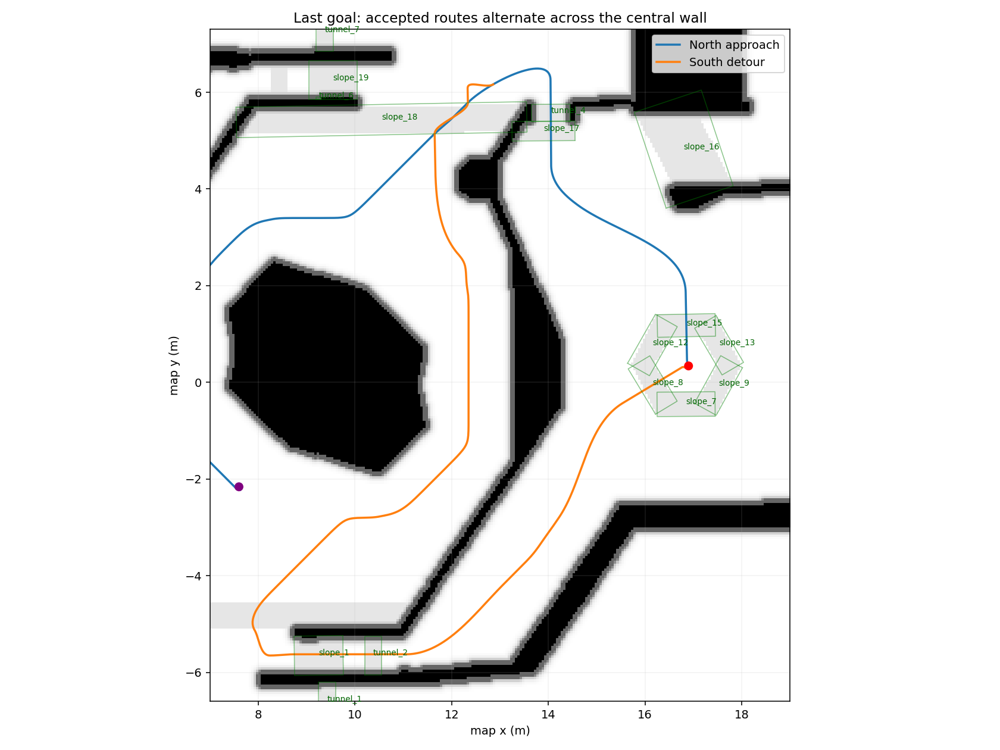

# 最新手动最后目标未到达（2026-11-14）

本轮针对 `/tmp/nav_manual_gui/localization_trace_1794654051212432777.jsonl`，与同日较早的 [堡垒坡面交界修复](../fortress_seam/README.md) 分开。最新最后目标约 `(16.90,0.34)`，原运行结束时距离目标 **5.226 m**，还未进入堡垒；不能用较早 `(16.79,0.61)` 的成功结果判定这次通过。

**状态：已复现导航循环，最后目标尚未修复。** 本轮实际保留的代码变化仅为回归脚本的残留进程检测和退出清理。原有坡面居中修改保留。未修改定位、地图、语义标注、足迹或碰撞阈值；规划权重试调已撤回；未提交 Git。

## 原运行与复测

最新 RViz 日志先后请求 `(16.93,0.52)`、`(17.07,0.55)`、`(7.61,-2.13)`、`(16.90,0.34)`。最后请求在 wall time `1794654357.744763988`，起点 `(7.60,-2.16)`。这些是不同 action，不能混在一起判断。更早 `(16.93,0.52)` 的 `slope_15` 出口航向约束失败，与后续路线循环也是两个问题。

| 运行 | 最后目标结果 | 最后记录到目标距离 | 证据限制 |
|---|---|---:|---|
| 用户手动运行 | 用户停止时未完成 | 5.226 m | 未录制原 action 四元数及完整规划路径 |
| `/tmp/nav_manual_lastgoal_replay` | 100 s timeout，取消 | 5.884 m | 发现同 domain 的旧障碍发布者，不能作为单套栈验收 |
| `/tmp/nav_lastgoal_clean` | 120 s timeout，取消 | 7.164 m | 已在首个目标开始阶段清除旧发布者；最后目标全程只有单套栈 |
| `/tmp/nav_lastgoal_cost2` | 120 s timeout，取消 | 6.322 m | 临时 cost=2；启动期一次 IMU gap reset，最后目标有短暂 SUSPECT，不是严格单变量对照 |

复测目标均为 map `'7.60 -2.16 -26' '16.90 0.34 0'`。原 RViz 完整朝向未知，因此属于相近位置复测。距离取各 trace 的最后定位样本，包含取消后的清理间隔，与 goals.log 的最后一秒采样可不同。

用户原最后目标的定位状态有 NORMAL 763 条、OBS_DEGRADED 42 条，**所有记录 pose_trusted=true、epoch=0**。按仿真采集时间匹配真值，平面位置误差 p95 **0.145 m**、最大 **0.230 m**；按 registration yaw 换算的航向误差最大 **0.793°**。无残留、默认参数复测同样全程可信、epoch 0，位置误差 p95 0.119 m。由此可以独立复现导航故障，不能把这次未到达简单归因于定位失信。这里仅比较平面轨迹，不证明地面高程或点云三维配准正确。

可复算统计见 `summary.json` 与 `summarize.py`。

## 已确认的导航行为

北侧路线经过 `slope_18` 与 `slope_17+tunnel_4`，再经 `slope_15` 上堡垒。运行时隧道附近被标记占用后，整形器/控制器的完整足迹检查正确阻止继续驶入，规划转而从南侧 `slope_1+tunnel_2` 绕行。随后北侧再次被视为可行，重规划把车引回，形成往返循环。`clean_default/nav.log` 和原复测 `replay_with_residual/nav.log` 保存整形、碰撞与改道过程；图中的路线取带残留复测的两条已接受路径，只用于解释路线拓扑。



带残留复测的一次具体碰撞：wall `1794655000.3106`，`slope_17+tunnel_4` 坡体 `(14.049,5.752,90.4°)`。最近 global costmap 快照中的占用格包括 `(13.925,5.625)`、`(14.025,5.625)`、`(14.125,5.725)`；对应静态地图灰度均为 230，并非静态 lethal。清理残留后的默认参数运行同样发生该通道的动态占用/停车，排除了“只因重复发布者”的解释。

清理后的观测记录在隧道附近窗口 `x=14.05±0.4, y=5.75±0.7` 中检出 586 个障碍点，相对栅格地面的高度中位数约 9.6 cm。它们不能仅凭坐标就被当作地面删除：该窗口同时存在坡面、洞口、顶棚和多层 CAD 表面。`cad_heights.json` 给出了完整 registration 下的 STL 竖直求交诊断，不能据此推导全图统一高程偏移。当前尚未区分这些命中中哪些属于真实障碍、边缘错配、地形高程问题或三维观测误差。原录制器也未保存原始 FrontendFrame 点云，后续精确核对应补录。

独立 planner/smoother 实验，在静态地图同一起点 `(7.60,-2.16)`：

| cost_travel_multiplier | 路径长度 | 走向 | 整形 |
|---:|---:|---|---|
| 3.0（正式） | 20.913 m | 北侧 | 通过 |
| 2.0（试调） | 14.779 m | 南侧 | 通过 |
| 1.0 | 14.607 m | 南侧 | 通过 |
| 0.0 | 14.404 m | 南侧 | 失败 504 |

从 `(12.17,2.57)` 出发，3.0/2.0 仍走北侧；1.0 的较短路径整形失败 504。真实 Gazebo 的 cost=2 试调也未到达，因此已撤回，不把“更短”当作“可通行”。静态隧道检查 cost=2 仍为既有 8/12，tunnel_2/5 双向失败；这些未关闭。完整探测数据见 `planner_probe.json`。

## 已保留的小修复与验证

发现旧回归的 PGID 2643 中，`terrain_obstacles.py` PID 2652 自 13:36 起存活，`ROS_DOMAIN_ID=78`、`GZ_PARTITION=nav_regress_1970`，与用户及复测使用同一 ROS domain。SIGINT、SIGTERM 后 helper 仍未退出，最终对已核实的旧 helper 使用 SIGKILL。

`run_nav.sh` 的启动冲突检查现包含 `terrain_obstacles.py`，防止仅剩该 helper 时漏检；退出时对本次记录的进程组，在 INT/TERM 后补一次 KILL。未对任意同名进程批量终止。临时模拟仅有残留 helper 的 ps 输出，脚本以状态 3 拒绝启动，见 `startup_guard.json`。`bash -n`、`git diff --check` 通过；本轮仿真已退出，没有运行中的导航/Gazebo/terrain_obstacles helper。未因 shell 小修复重复跑 C++ 单测，原坡面居中修复的单测结果仍见其独立报告。

第一次 clean 运行期间修改正在执行的脚本，导致该次脚本末尾产生 shell 解析错误；当时目标已完整跑到 120 s 超时，EXIT 清理也已执行。此错误不解释此前的运行中导航循环。随后启动的 cost2 运行使用完整脚本，正常完成清理。保留该控制台原文，避免隐藏测试限制。

## 后续工作与归档

未解决项是通道运行时占用的来源，以及频繁改道造成的循环；不是继续放宽足迹或关闭碰撞检查。后续需在相同位置补录原始 FrontendFrame 点云、精确时刻 TF、障碍输出和完整 costmap，逐格核对洞口/坡面的实际支撑面，再决定修复观测过滤、标注或路线选择。`slope_15` 的近出口目标航向约束还应单独验收。

复测命令：

```bash
GUI=false RVIZ=false LOC_REC=true GOAL_FRAME=map GOAL_TIMEOUT=120 \
OUT=/tmp/nav_lastgoal_new PLAN_REC=/tmp/nav_lastgoal_new/plans.txt \
CM_REC=/tmp/nav_lastgoal_new/costmaps OBS_REC=/tmp/nav_lastgoal_new/observations.txt \
bash tools/nav_regress/run_nav.sh '7.60 -2.16 -26' '16.90 0.34 0'
```

大型 trace、观测与代价图在本机 `backup/manual-last-goal-2026-11-14.tar.zst`，文件清单和 SHA256 见 `archive.json`；不纳入 Git。小型原始日志、控制台、规划结果、关键分析输入和脚本保留在本报告目录。
